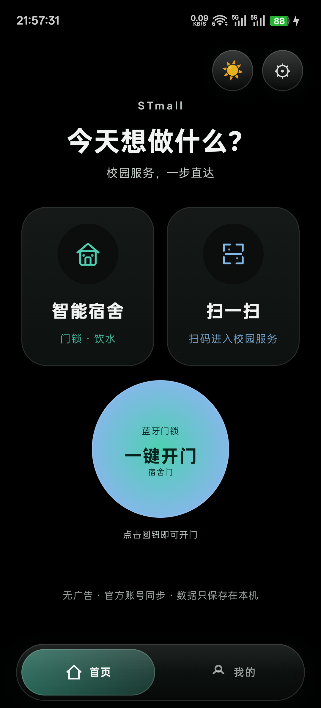

<div align="center">
  

  <h1>Cumpus</h1>

  <p>面向校园高频场景的独立 Android 客户端</p>

  <p>
    <strong>项目已暂时转为闭源，不再公开更新源码</strong> ·
    <a href="docs/USAGE.md">使用教程</a> ·
    <a href="docs/CHANGELOG.md">更新记录</a> ·
    <a href="DISCLAIMER.md">免责声明</a>
  </p>
</div>

> **闭源状态（2026-10-26）**
>
> STmall 自有代码与项目材料暂时转为闭源，GitHub 仓库已设为私有并归档，
> 不再通过公开 GitHub 仓库发布源码更新。已经发布的版本、第三方组件及其
> 许可证不会因本次状态调整而失效。后续是否恢复公开由项目作者决定。

> **STmall 是非官方个人项目，与天猫、淘宝、阿里巴巴、慧生活798及其关联
> 服务商没有隶属、授权或合作关系。请仅使用自己的账号，并只操作自己有权使用
> 的门锁和设备。**

Cumpus 将天猫校园的智能宿舍、蓝牙门锁、校园饮水，以及慧生活798的多账户、
钱包、积分、账单、设备标签等高频入口集中到一个无广告首页。项目不会修改、
注入或重新签名官方应用。

## 界面预览

<p align="center">
  
</p>

## 主要功能

- 主界面分为“主页 / 功能 / 我的”三页，支持日间、跟随系统和纯黑暗黑模式。
- “智能宿舍”“慧生活”“U净”“胖乖生活”“完美校园”“一键开门”“一键接水”“扫一扫”“U净扫一扫”模块可独立显示或隐藏。
- 自绘矢量图标与自适应布局，兼容不同屏幕尺寸、字体缩放和系统栏高度。
- 底部液态玻璃导航栏通过官方 Backdrop 采样页面背景，叠加模糊、圆角透镜、
  高光、弹性胶囊和按压反馈。
- 底部胶囊支持跟手拖动、选中渐变和弹簧吸附，切换后执行滑入滑出动画。
- 扫描入口统一跳转到独立扫描页，页面只保留“取消扫码”；“功能”和“我的”模块卡尺寸与位置一致。
- 支持从本机官方天猫校园导入已有登录态，用于校园身份校验与饮水服务。
- 支持校园饮水设备识别、只读状态查询与接水操作。
- 支持抓取自己门锁的凭证、Keystore 加密保存、离线蓝牙开门和电量查询。
- 支持慧生活798多账户、独立用水/积分登录、设备启停和收藏设备同步。
- 支持慧生活钱包余额、充值、积分签到、任务执行与消费账单。
- 支持 U净手机号登录、扫码收藏多台洗衣机、空闲状态、订单倒计时、
  Nordic/Cypress 蓝牙启动、机身时间同步与支付宝订单支付。
- 支持胖乖生活短信登录、扫码设备、最近设备、服务项和历史订单。
- 支持完美校园学校代码、绑定房间、水电剩余和近七日用量只读查询。
- 主页提供一键开门、一键接水、胖乖扫一扫和 U净扫一扫；其余校园服务集中在横向功能卡片中。
- STmall“我的”使用“天猫校园 / 慧生活”双入口，分别进入两套账户与服务。
- “我的”还提供 U净账号入口；门锁、饮水机和 U净设备添加后均可重新命名。
- 首页、 “我的”和模块子页统一使用液态玻璃组件与弹簧按压反馈。
- 设置页提供液态玻璃总开关；关闭后按钮、单选控件、卡片和底栏统一使用
  无模糊、无透镜高光的纯色平面回退。
- 慧生活登录、账户、钱包、积分、任务、设备添加及主页长按选择弹窗统一使用液态玻璃容器。
- 日间/暗黑切换使用颜色渐变和触摸点扩散；文字保持在过渡遮罩上方。
- 页面转场使用可连续打断的弹簧滑动，主题遮罩、文字与系统栏同步平滑换色。
- 支持选择本机图片作为三页背景，并在重启后保持；也可一键恢复默认背景。
- Android 12 及以上使用真实背景模糊，Android 13 及以上启用透镜折射；
  Android 8–11 自动使用轻量玻璃回退。
- 支持 NFC NfcA/Ndef 标签读写，以及 `i.ilife798.com/nfc.html` 碰一碰入口。
- 支持慧生活桌面小部件和“启动设备”快捷设置磁贴。
- “我的订单”“地址管理”通过官方深链打开对应官方页面。
- 提供下拉快捷磁贴和桌面开锁快捷方式。
- 登录 Cookie、慧生活账户、Token 与门锁凭证不进入系统备份。

## 系统要求

- Android 8.0 或更高版本，`minSdk 26`。
- 设备支持 Bluetooth LE；门锁功能还要求手机蓝牙已开启并位于门锁附近。
- 官方天猫校园或慧生活798现有可用账号。
- NFC 功能要求手机支持 NFC；不支持 NFC 的手机仍可使用其他模块。
- Shizuku 用于首次同步登录态、读取日志或抓取门锁凭证。
- 不需要已保存凭证后的日常离线开门权限，也不要求修改 Root 或系统分区。

## 快速开始

1. 安装项目作者提供的本地 `STmall_*.apk`。
2. 安装并登录官方天猫校园。
3. 安装 Shizuku，根据系统版本通过 USB ADB 或无线调试启动它。
4. 在 Shizuku 中授权包名 `com.rea.campuslite`。
5. 打开 STmall，在“我的”中同步官方天猫校园登录。
6. 进入“功能 → 慧生活”，完成自己的慧生活用水登录并按需添加设备。
7. 进入“功能 → U净”完成登录；首页可用“U净扫一扫”直接打开设备页。
8. 进入“功能 → 智能宿舍”，按需配置门锁凭证或选择天猫校园饮水设备。
9. NFC 或扫码添加设备时，进入“慧生活 → 设备 → +”，选择“NFC 碰一碰”或“扫码识别”。

完整的无 Root 登录导入、门锁首次录入、饮水扫码和故障排查步骤见
[使用教程](docs/USAGE.md)。

## 慧生活与 NFC

慧生活功能作为 STmall 内的独立模块构建，包名仍为 `com.rea.campuslite`，
不是一个需要另行安装的应用。账户和 Token 使用 Android Keystore AES-GCM
加密，设备与账户列表不会以明文写入 SharedPreferences。

NFC 支持原版慧生活设备标签格式：

```text
https://i.ilife798.com/nfc.html?q=<设备编号>
```

碰一碰读取后可把设备编号直接带入“添加到慧生活”页面。写入前必须确认标签属于
自己有权管理的设备。当前版本只实现 NfcA/Ndef 标签读写，不包含云卡模拟、
HCE APDU 或第三方门禁卡复制。

## 无 Root 登录态导入

部分厂商的 WebView 不生成可由 Shizuku 直接读取的 Cookie 数据库。此时可运行
仓库内的辅助脚本，从官方 WebView 的只读 DevTools 通道导入登录态：

```powershell
.\tools\ImportNoRoot.ps1 `
  -Adb "$env:ANDROID_HOME\platform-tools\adb.exe" `
  -Serial "<手机序列号>"
```

脚本不会在终端输出 Cookie 值，但会在手机临时路径写入导入文件。同步完成后
应立即删除：

```powershell
adb -s <手机序列号> shell rm -f /data/local/tmp/campus_lite_cookies.json
```

## 门锁凭证与离线开门

首次使用门锁时：

1. 打开“智能宿舍 → 门锁”，点“开始抓取”。
2. 切回官方天猫校园，在蓝牙已开启且靠近自己门锁时，完成一次合法开锁。
3. 回到 STmall，确认抓到的门锁地址和 `activationKey` 已自动填入。
4. 保存凭证。之后即可在本机离线连接并开锁。

`activationKey` 等同于门锁钥匙，不应截图、公开、上传或发送给他人。请勿向
不属于自己的设备发送开锁帧。

## 构建

构建环境：

- JDK 21
- Android SDK 35 或更高
- Gradle Wrapper 8.11.1
- Node.js 仅在运行 WebView Cookie 导入工具时需要

```powershell
git clone https://github.com/Yunanriv-hub/STmall.git
Set-Location STmall

$env:JAVA_HOME = '<JDK 21 安装目录>'
$env:ANDROID_HOME = '<Android SDK 目录>'
$env:ANDROID_SDK_ROOT = $env:ANDROID_HOME
$env:GRADLE_USER_HOME = Join-Path (Get-Location) '.gradle-home'

.\android\gradlew.bat `
  -p android `
  testReleaseUnitTest `
  assembleRelease `
  --no-daemon `
  '-Pkotlin.compiler.execution.strategy=in-process'
```

产物路径：

```text
android/app/build/outputs/apk/release/app-release.apk
```

仓库不包含签名密钥。自行构建发布包时，请创建本地
`android/keystore.properties` 并按自己的密钥签名；该文件、JKS/Keystore
和构建产物均已加入 `.gitignore`。

慧生活签名接口需要本地 `android/life798.properties`。可从
[`life798.properties.example`](android/life798.properties.example) 复制后，
填写你有权使用的本机配置。该文件已被 Git 忽略，不得随源码或 Release 分发。

胖乖生活协议需要本地 `android/pangguai.properties`。可从
[`pangguai.properties.example`](android/pangguai.properties.example) 复制后
填写本机配置；真实值已被 Git 忽略，不应提交或公开。

## 当前版本

| 项目 | 值 |
|---|---|
| 版本 | `0.6.8` |
| versionCode | `33` |
| 包名 | `com.rea.campuslite` |
| minSdk | `26` |
| targetSdk | `36` |
| Release APK | `Cumpus_0.6.8.apk` |
| SHA-256 | `2DF4BE4B07245D84D534E6DF7A64247BC89D846779A23F93F4741B31BAEBF365` |

该版本已通过 285 项 JVM 单元测试、release 编译、Android Lint 关键检查和
v2 签名校验。

## 兼容性说明

- 已在 OPPO PGGM10、Android 14、1080×2412 真机验证主页、功能页、我的页、
  慧生活四个入口、U净返回路径、扫码取消、模块开关、主题切换和背景图片持久化。
- 已在 OnePlus PLQ110、Android 16、1080×2378 和 720×1280 小屏参数下验证
  首页布局、主题切换、底部导航、模块开关和官方页面跳转。
- 已在 OnePlus PLQ110 上验证 STmall 首页、慧生活主页、登录页、NFC 页面和
  NFC 设备编号回填流程；实际标签写入仍需使用本人 NFC 标签验证。
- 使用系统字体缩放 1.3 验证过文字不重叠、不被截断。
- 已在 OPPO PGGM10 真机验证胖乖生活登录页、首页双扫码模块、扫描页单按钮、
  慧生活底栏来源、玻璃弹窗以及功能页/我的页四张卡片对齐。
- 已在 HONOR `Hera-BD00`、Android 11、无 Root 环境验证 Shizuku 启动、
  登录态导入、校园身份检查、饮水只读查询和门锁结果回传。
- 不同厂商的窗口管理、状态栏高度、后台限制和 WebView 实现可能不同；
  本项目不能保证覆盖所有 Android ROM。

## 隐私与安全

- 本项目不附带账号、Cookie、`activationKey`、手机号、签名密钥或设备数据。
- 登录 Cookie、慧生活账户/Token 和门锁凭证由 Android Keystore 加密，并明确
  排除系统备份。
- 抓取服务只面向本机官方天猫校园和用户已授权的 Shizuku 通道。
- 请勿在 Issue、讨论区或截图中公开 Cookie、`activationKey`、完整手机号、
  门锁序列号或设备日志。安全问题请遵循 [SECURITY.md](SECURITY.md)。
- “清除本机登录态”只删除 STmall 本地保存的会话，不修改官方应用。

## 已知限制

- STmall 不提供伪造登录、支付、下单或绕过官方权限的能力。
- 订单页要求官方账号登录态有效；失效时可能先进入官方登录页。
- 校园饮水和订单接口可能随服务端更新而变化。
- 蓝牙连接会受到距离、电量、系统后台策略和门锁固件状态影响。
- NFC 标签读写只支持兼容 NfcA/Ndef 的标签；标签被锁定、加密或格式不兼容时
  无法写入。
- 当前版本不实现慧生活云卡 HCE、APDU 刷卡、支付密码或第三方门禁卡复制。
- 慧生活积分任务可能导致账号限制、积分冻结或不到账，请自行确认服务规则。
- 已保存凭证可用于离线开门，但手机重启后若需重新同步或抓取，仍要重新
  启动 Shizuku。

## 参考项目与地址

门锁协议、日志抓取方式和校园饮水接口的研究参考：

- TMallKey：<https://github.com/lmc2007/TMallKey>
- TMallKey 文档：<https://lmc2007.github.io/TMallKey/>

慧生活账户、饮水、钱包、积分和账单协议参考：

- life-798：<https://github.com/nocookies111/life-798>

液态玻璃交互和底栏视觉原则参考：

- AndroidLiquidGlass：<https://github.com/Kyant0/AndroidLiquidGlass>
- Backdrop 文档：<https://kyant.gitbook.io/backdrop>
- GlassExplorer（交互概念参考，未复制代码）：
  <https://github.com/ktiays/GlassExplorer>

应用图标由项目提供者提供，图标来源标注为：

- Unoline Icons Set：<https://iconstore.co/icons/unoline-icons-set>

## 第三方许可

- TMallKey 参考项目采用 MIT License，许可文本见
  [LICENSE-TMallKey](LICENSE-TMallKey)。
- AndroidLiquidGlass 参考项目采用 Apache License 2.0，许可文本见
  [LICENSE-AndroidLiquidGlass](LICENSE-AndroidLiquidGlass)。
- life-798 参考项目采用 MIT License，许可文本见
  [LICENSE-life798](LICENSE-life798)。
- 胖乖生活参考 `Night-stars-1/wash` 的公开接口行为，未复制其签名配置、
  明文 Token 存储或源码；安全审查见
  [PANGGUAI_SECURITY_AUDIT.md](docs/PANGGUAI_SECURITY_AUDIT.md)。
- 完美校园只独立实现 Apifox 文档中的房间水电查询，不接入
  `WanMeiXiaoYuanCheckin` 的登录、虚拟设备 ID、打卡或任务代码；安全审查见
  [PERFECT_CAMPUS_SECURITY_AUDIT.md](docs/PERFECT_CAMPUS_SECURITY_AUDIT.md)。
- U净网络与蓝牙协议参考 `baijuqi/ujing-mini`，采用 MIT License，
  许可文本见 [LICENSE-ujing-mini](LICENSE-ujing-mini)。STmall 未复制
  `DUT-Ujing` 的签名密钥、Web 服务或项目代码。
- 第三方项目名称、商标和图标权利归各自权利人所有。
- STmall 自有代码按照 [LICENSE](LICENSE) 作为专有、闭源软件保留全部权利；
  未经项目作者明确书面授权，不得复制、修改、再分发或商用。
- 第三方许可见上列专用许可证文件；第三方许可不会授予 STmall 自有代码的使用权。

## 免责声明

本项目仅用于个人学习和本人设备管理。使用者必须遵守所在地法律法规、官方
平台服务条款、学校宿舍管理规定以及设备所有者的授权范围。

本项目与天猫、淘宝、阿里巴巴、慧生活798、学校、门锁厂商及 Shizuku 项目无
隶属或授权关系。作者不保证功能的持续性、准确性、安全性或适销性，也不对因
使用或无法使用本项目造成的账号受限、积分损失、数据丢失、门锁故障、财产损失
或人身伤害承担任何责任。请勿将本项目用于未授权访问、破解、绕过访问控制或
其他违法用途。

完整免责声明见 [DISCLAIMER.md](DISCLAIMER.md)。
